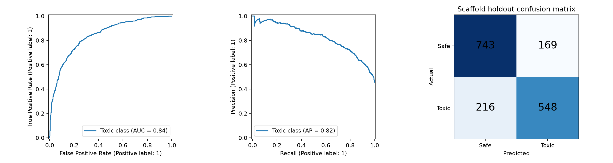

# 독성 모델링 결과 · 2026-10-02

**최종 모델은 LightGBM(31 leaves, 600 trees)이며, 골격 holdout ROC-AUC 0.8448, Accuracy 77.03%, 비독성 F1 0.7942, 독성 F1 0.7400이다.** 개발 OOF에서 고른 독성 threshold는 0.45다. 927개 입력의 결과파일을 생성했다. 외부 Leaderboard 점수는 아직 확인하지 않았다.

- [제출용 CSV](predict_output_모델예측.csv): SMILES,output 두 컬럼, 927행. output 1=비독성 495행, 0=독성 432행.
- [실행 결과 포함 노트북](../04_노트북/독성_모델링_계열분리_검증과예측.ipynb)
- [모델 비교](model_comparison.csv), [fold별 점수](cv_folds.csv), [특징 비교](feature_ablation.csv)
- [오류 사례](holdout_errors.csv), [예측 범위 진단](prediction_diagnostics.csv), [모델/전처리 묶음](toxicity_model.joblib)

## 데이터와 전처리

학습8349행, 개발6673행, 평가1676행, 예측927행이다. label은 작업 데이터에서 1=독성/0=비독성이므로, 과제 PDF13·15쪽의 원본 제출 규약(1=비독성/0=독성)으로 반드시 되돌렸다.

어제 표준 Morgan+8개 EDA 및 최신10장 발표를 읽고 같은 입체 파서를 재사용했다. 전체8349행의 Morgan 및 입체8개를 다시 계산하여 어제 최종 CSV의 모든 숫자 입력과 일치함을 확인했다. 예측927행에도 같은 파싱·사전·순서를 적용했다. 입력은 Morgan1024 + FCFP1024 + PTFP975 + 물성4 + 전역 입체3 = 3030변수다. 원본 label/SMILES/특징/파일은 바꾸지 않았다.

기존 국소5개는 전체 데이터의 label 충돌을 보고 선정했으므로 최종 후보에서 제외했다. +8 LightGBM은 탐색용으로만 계산했고 최종 선택에 쓰지 않았다. 전역3개와 Morgan은 label을 읽지 않고 분자 구조로 계산한다. 상수49개 제거는 이미 EDA에서 전체 입력으로 정해진 비지도 작업이다.

## 평가 설계

4,160개 Bemis–Murcko 골격을 사용했다. 입체변형이 같은 그룹에 남도록 골격 chirality를 제외했다. 무고리 구조는 하나의 ACYCLIC 그룹이다. seed42, 5분할의 첫 fold를 holdout으로 잠그고 나머지에서 4분할 그룹CV를 진행했다. 모든 CV/holdout 경계의 골격·연결구조 중복0건을 검증했다. 연속값 scaling은 각 학습 fold 안에서만 맞췄다.

9개 기준/후보 모델과 상위3개 평균을 비교했다. 개발OOF AUC로 단일 모델을 고르고, 평균은 0.002 이상 개선해야 쓰기로 사전 결정했다. 평균AUC는 0.8422로 단일0.8448보다 낮아 채택하지 않았다. threshold는 개발OOF macro-F1으로 골랐으며 holdout은 그 이후 평가했다. holdout 평가모델은 개발6673행으로 학습했고, 제출모델은8349행 전체로 다시 학습했다.

## 최종 holdout 지표

| 지표 | 값 |
|---|---:|
| ROC-AUC | 0.8448 |
| AUC 골격bootstrap95% 구간 | 0.8154–0.8701 |
| Accuracy | 77.03% |
| 비독성 Precision / Recall / F1 | 0.7748 / 0.8147 / 0.7942 |
| 독성 Precision / Recall / F1 | 0.7643 / 0.7173 / 0.7400 |
| Macro-F1 | 0.7671 |
| 독성 기준 Specificity | 0.8147 |
| 비독성 기준 Specificity | 0.7173 |
| 독성 PR-AUC / 비독성 PR-AUC | 0.8246 / 0.8580 |
| Brier score | 0.1611 |

독성label을 positive로 읽는 혼동행렬: 비독성 정답743, 비독성→독성169, 독성→비독성216, 독성 정답548. 다수 클래스 기준선 accuracy는54.42%, AUC0.5다. 임계값0.5의 결과도 별도 기록했지만 최종 threshold를 holdout 점수로 다시 고르지 않았다.

## EDA 가설을 모델링에 연결한 결과

동일 LightGBM/fold의 후속 개발데이터 ablation이다. **추가 모델 선택 또는 holdout 재평가에 사용하지 않았다.**

| 입력 변화 | 개발 OOF AUC | 전체 Morgan+전역3 대비 |
|---|---:|---:|
| 전체 Morgan+전역3 | 0.844824 | 기준 |
| 기존ECFP, 입체요약 없음 | 0.844551 | -0.000273 |
| 전역3개 제거 | 0.844707 | -0.000117 |
| PTFP 제거 | 0.841164 | -0.003660 |
| Morgan+물성+전역3만 | 0.825298 | -0.019526 |
| 물성/전역3 제외, fingerprint만 | 0.829028 | -0.015796 |

현재는 여러 fingerprint와 물성의 결합이 단일Morgan보다 유리했다. 입체요약의 평균AUC 개선은 매우 작았고, 국소5개 추가 모델의 OOF값은 기준과 같았다. **표현 충돌0건으로 만들었다는 EDA 결과가 평균 독성 예측 개선을 보장하지 않았다.** 단일분할 점수의 작은 차이는 유의한 우열로 단정하지 않는다. 기존ECFP 설정이 불명이라 Morgan 효과를 chirality만의 효과로 해석하지 않는다.

논문별 반영은 [논문반영.md](논문반영.md)에 있다. MolToxPred의 특징결합/트리·부스팅 비교, Baimacheva의 입체표현/쌍보존 평가, Born/ToxiM의 표현과 hybrid 비교를 참고했다. 원 연구의 성능을 이번 성능으로 옮기지 않았다.

## 적용 범위와 오류

예측927개 가운데 학습에서 본 골격627개, 본 연결구조81개, 정규화 입체구조까지 같은 것은1개다. 가장 가까운 학습Morgan Tanimoto의 중앙값은 0.803이다. 낮은 유사도/임계값 부근 사례는 `prediction_diagnostics.csv`에서 확인할 수 있다. 81개 연결구조 중복을 무조건 label 복사하는 방식은 쓰지 않았다.

예측확률은 별도 보정하지 않은 모델 출력이다. 유사도·확률로 임상 안전성이나 독성 기전을 확정하지 않는다. 이전 EDA가 전체 label을 보았기 때문에 완전히 새로운 외부검증이라고 말할 수 없고, 현재label의 독성 endpoint/농도/조건은 아직 미확인이다. 골격이 달라도 유사 분자가 존재할 수 있다.

## 재현 및 검증

실행 스크립트는 `03_분석/스크립트/train_toxicity_models.py`다. 기존환경 `.venv_eda`와 [버전 고정](requirements-modeling.txt)을 사용한다. 노트북 기본모드는 저장결과를 표시하고 제출을 재추론해 검사한다. `RETRAIN=True`이면 전체 학습 및 후속ablation을 다시 수행한다.

실행가능 self-check: `--self-check`. 새 입력 추론: `--predict 입력CSV --output 새CSV`. 초기 모델비교/학습 약 304초, 후속ablation 별도. API 호출0회.

원본train/최종EDA CSV/predict_input/예시predict_output/반전전backup/기존EDA노트북 SHA-256 보존, 전처리 전체행일치, 모델저장후재추론일치, 제출927행·2열·컬럼명·SMILES원문/순서·0/1·label반전을 모두 검사했다. 원본예시output은 모델학습/성능평가의 정답으로 사용하지 않았다.

## 모델이 실제로 사용한 특징

[특징 중요도](feature_importance.csv)와 [특징군 중요도](feature_family_importance.csv)는 전체학습 LightGBM의 split/gain 집계다. 중요한 숫자는 모델의 분할 기여도이며 독성의 생물학적 원인을 의미하지 않는다. 모델이 실제로 각 입체변수에 분기했는지 이 표에서 확인할 수 있다.

[최종 검증 기록](최종_검증.json): 모델링노트북 코드9셀 실행, 오류출력0건, 저장모델927행 재추론일치, 보호원본hash일치.
